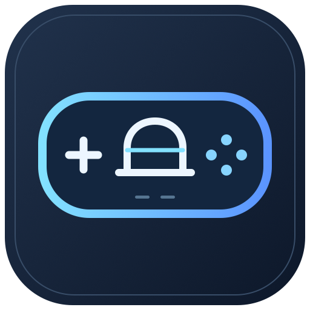
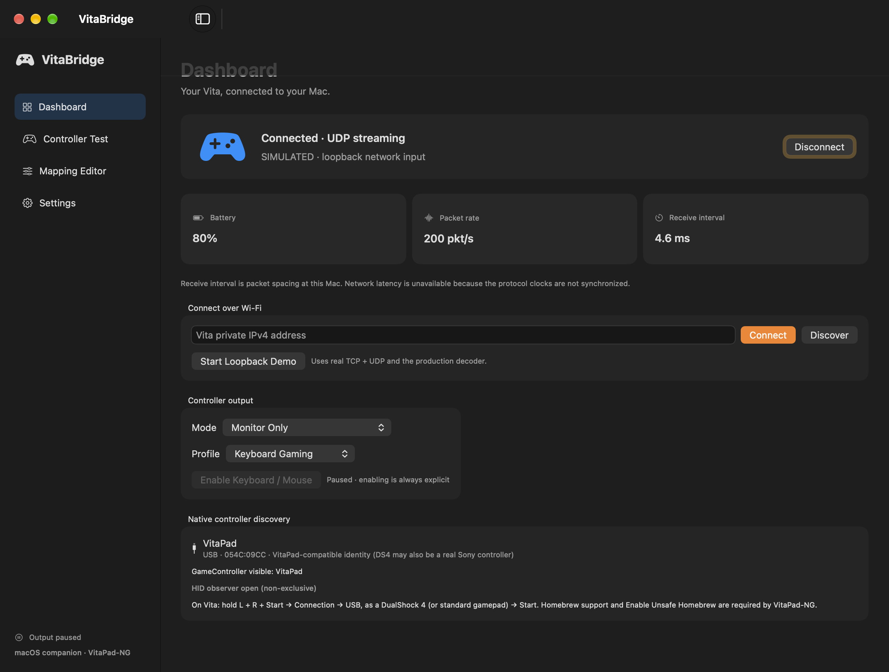
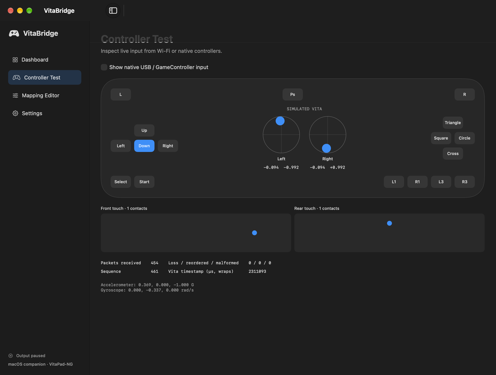

<p align="center">
  
</p>

<h1 align="center">VitaBridge</h1>

<p align="center"><strong>Use your PlayStation Vita with your Mac.</strong></p>

VitaBridge is a native macOS companion for [VitaPad-NG](https://github.com/bclarke123/VitaPad-NG): receive controller input over Wi-Fi, create keyboard/mouse profiles, and inspect the Vita's native USB controller input. Built with Swift 6, SwiftUI, Network.framework, GameController and IOKit.

> **Early release:** the maintainer reports Wi-Fi connectivity and native USB input working on a real Vita. Automated tests cover the protocol and simulator. USB button mappings still need checking, and compatibility with individual games is not guaranteed. See [verification](docs/VERIFICATION.md).

## Recommended connection: USB

**Use USB DualShock 4 mode for native controller support, including in Astris.** The Vita presents a gamepad directly to macOS, and compatible games receive its input without keyboard/mouse translation. Check the game's controller selection and button mappings; compatibility is still consumer-dependent.

**Wi-Fi currently works as a configurable keyboard/mouse bridge, not a wireless gamepad.** Seeing input in VitaBridge's Controller Test confirms reception, but does not mean a game has received controller input.

| Connection | What the game receives | Best use |
| --- | --- | --- |
| USB, as a DualShock 4 | Native gamepad input, where the game recognizes it | **Preferred** for controller-enabled games and emulators |
| Wi-Fi with Keyboard / Mouse enabled | Mapped keyboard presses, mouse movement and mouse clicks | Games configured for keyboard/mouse controls |
| Wi-Fi in Monitor Only, or with output paused | No injected input | Input visualization and diagnostics |

## What works

- **Wi-Fi input:** LAN discovery, manual private IPv4, NG V2 TCP validation, UDP streaming, heartbeat, polling fallback and automatic reconnection.
- **Keyboard/mouse output:** editable keys, shortcuts and clicks; left-stick movement and continuous right-stick mouse movement; explicit Accessibility permission.
- **Profiles:** Keyboard Gaming, FPS Keyboard/Mouse, Emulator and an inert Standard Gamepad template; duplication, atomic save, JSON import/export, dead zones, sensitivity, calibration and axis inversion.
- **Live diagnostics:** buttons, sticks, front/rear touch, motion and battery when provided; receive rate, packet spacing and sequence diagnostics.
- **Native USB observation:** HID identity/transport, GameController visibility and live input. Games receive USB input directly without an emulated duplicate controller.
- **Menu-bar controls:** profile switching, output pause, connection status and clean quit.
- **Input release protection:** neutral on disconnect/pause, 300 ms freshness timeout and a separate release helper for parent exit/stall.
- **Hardware-free demo:** an original loopback simulator exercises the production TCP/UDP decoder and mapping pipeline.

**Wireless virtual-gamepad output is unavailable.** This build does not have Apple's restricted virtual-HID authorization/provisioning. Wi-Fi supplies keyboard/mouse output; native gamepad input uses USB. No SIP changes, third-party Mac driver or administrator privileges are required for normal use.

## Screenshots

Captured from the app's production SwiftUI views with **live loopback demo input** and **output paused**. These images illustrate the interface, not game compatibility or real-device network performance. Native USB inventory, if shown, reflects devices present at capture time.

### Dashboard

Connection status, receive statistics, profile selection and controller discovery.



### Controller Test

Live button highlights, both sticks, touch contacts and motion/packet diagnostics.



The original logo and screenshot regeneration instructions are in [docs/assets](docs/assets/README.md).

## Requirements

| Mac | Vita |
| --- | --- |
| macOS 14 or later | A PS Vita already configured for homebrew |
| Full Xcode with Swift 6 to build | **VitaPad-NG**, not another project named VitaPad |
| Apple Silicon; Intel also builds | NG's documented **Enable Unsafe Homebrew** setting |
| Accessibility only for keyboard/mouse injection | Data-capable cable for USB, shared trusted LAN for Wi-Fi |

The app has been built and launched on Apple Silicon; an arm64/x86_64 universal binary was compiled. Runtime checks on Intel and macOS 14 remain pending.

## Download VitaPad-NG for your Vita

**[Download VitaPad.vpk — VitaPad-NG v1.9.2](https://github.com/bclarke123/VitaPad-NG/releases/download/v1.9.2/VitaPad.vpk)**

Install this file **on your PS Vita using VitaShell**, not on your Mac. It supports the Wi-Fi and USB modes described below and includes its kernel module. Use this NG version rather than another similarly named VitaPad project. If the direct download does not open, use **Assets → VitaPad.vpk** on the [v1.9.2 release page](https://github.com/bclarke123/VitaPad-NG/releases/tag/v1.9.2).

## Build and launch

The Xcode project is included. No external Swift package dependencies are required.

```sh
./scripts/build.sh
open build/Build/Products/Release/VitaBridge.app
```

Alternatively, open `VitaBridge.xcodeproj`, select **VitaBridge**, and Run. Install full Xcode and select it as your active developer directory first. XcodeGen is needed only when regenerating `project.yml` changes (`xcodegen generate`; project generated with 2.45.4).

Local builds are ad-hoc signed, hardened-runtime enabled and **not notarized**. Public binary distribution needs an appropriate signing/notarization workflow. A stable signing identity also helps retain Accessibility approval across builds.

## Connect over Wi-Fi

### How the current implementation works

VitaPad-NG sends buttons, sticks and available touch/motion/battery data over the LAN. VitaBridge decodes that data for live monitoring. When you explicitly enable **Keyboard / Mouse** output, the mapping engine converts configured controls into CoreGraphics keyboard and mouse events sent to the **focused application**. The default left stick sends WASD and the right stick moves the mouse; these are not gamepad axes delivered to the game. Touch and motion visualization do not automatically become game gestures or gyro aiming.

This build **does not publish a virtual Xbox, PlayStation or other game controller over Wi-Fi**. A game may continue to display keyboard prompts, and a controller-only input selection will not receive this mapped output. Use the game's keyboard/mouse settings and match its bindings to your VitaBridge profile. For native gamepad use in Astris, use the recommended USB path instead.

The missing wireless virtual-gamepad backend requires legitimate Apple virtual-HID authorization/provisioning, implementation and separate consumer testing. Granting Accessibility access enables keyboard/mouse injection only; it does not unlock wireless gamepad output.

### Enable Wi-Fi keyboard/mouse output

1. [Download VitaPad-NG v1.9.2's VitaPad.vpk](https://github.com/bclarke123/VitaPad-NG/releases/download/v1.9.2/VitaPad.vpk) and install it on the Vita using your existing homebrew installer. Its VPK includes its kernel module. No separate kernel-plugin configuration is needed for the inspected NG release.
2. Enable **Unsafe Homebrew** in the Vita's HENkaku Settings, as required by NG, then open VitaPad.
3. Join the same trusted private LAN as your Mac. In VitaPad, hold **L + R + Start**, choose **Connection → Wi-Fi**, then press Start to save.
4. In VitaBridge, click **Discover**, or enter the IP shown on the Vita and click **Connect**.
5. Open **Controller Test** and check your controls before enabling output.
6. To control a keyboard/mouse game, choose **Keyboard / Mouse** and **Keyboard Gaming** (or **FPS Keyboard/Mouse** for mouse clicks). Read the permission explanation in Settings, grant Accessibility, explicitly **Enable Keyboard / Mouse**, then focus the game. Do not select **Standard Gamepad** expecting wireless controller output; it is an inert template.
7. Configure the game for keyboard/mouse input and match its bindings to the profile. After changing profiles, mappings or output mode, click **Enable Keyboard / Mouse** again because those changes pause output.

For Accessibility: open **VitaBridge → Settings → Grant Accessibility…**, then **macOS System Settings → Privacy & Security → Accessibility** and enable VitaBridge. If it is missing, add the built `VitaBridge.app` using **+**. Quit/reopen the app if the permission status does not refresh, then explicitly re-enable output. Monitoring and native USB input do not need this permission.

The Mac initiates TCP 5000 and UDP 5001 to the Vita; discovery uses UDP 5000. NG app 1.9+ streams UDP, while older V2 versions fall back to TCP polling. The protocol is unauthenticated: only enable injection on a trusted network. Packet spacing is shown as a receive interval, **not measured network latency**.

## Connect over USB (preferred)

1. Pause/disconnect Wi-Fi output in VitaBridge.
2. On the Vita, hold **L + R + Start**, select **Connection → USB, as a DualShock 4**, and press Start to save.
3. Connect a USB **data** cable and keep VitaPad running.
4. In VitaBridge's Controller Test, enable **Show native USB / GameController input**.
5. Choose the recognized controller in your game's controller settings. Leave VitaBridge keyboard/mouse output paused: macOS receives the gamepad directly.

The controller may be named DualShock 4, PS4 Controller or Wireless Controller even when wired. NG also has a generic USB mode, with different consumer compatibility. A real Sony DS4 shares the emulated DS4 identity, so identity alone cannot prove the device is a Vita. No Wi-Fi IP or Connect button is needed for native USB.

**Check button mappings before playing.** A maintainer test reported Vita Start appearing as R1. Do not assume Start reaches a game's +/Options input. Inspect the actual input, check/reset VitaPad-NG's own remappings, and use consumer/macOS customization where available. This issue has not been independently resolved or verified.

## Default keyboard controls

| Vita input | Keyboard Gaming action |
| --- | --- |
| Left stick | WASD |
| Right stick | Mouse movement |
| Cross / Circle | Space / Escape |
| Square / Triangle | E / R |
| L / R | Left Shift / Left Control |
| Start / Select | Return / Tab |
| D-pad | Arrow keys |

**Mouse clicks:** Keyboard Gaming has no default mouse-click binding; R sends Left Control. Choose **FPS Keyboard/Mouse** for **R → left-click** and **L → right-click**, then re-enable output. You can assign **Left Mouse** or **Right Mouse** to another input in Mapping Editor, save, and re-enable output.

**Standard Gamepad is a template, not a wireless virtual controller.** Save changes in Mapping Editor. Profiles live at `~/Library/Application Support/VitaBridge/profiles.json`. USB mappings are handled by the Vita, macOS or the receiving game; VitaBridge's keyboard editor does not rewrite the native USB device.

## Try without hardware

Click **Start Loopback Demo**, then open Controller Test. The clearly marked simulated samples pass through real sockets and the production decoder. The app/demo does not require Python.

The demo uses loopback **15000/15001**, avoiding macOS AirPlay Receiver's common TCP 5000 listener. It never changes the production Vita ports. Stop other demos/test simulators before starting it. Output starts paused; grant permission and enable it only if you intend to inject input.

## Build, test and package

```sh
# Unit tests and original loopback network test; upstream-specific tests skip:
./scripts/test.sh

# Fetch the inspected NG source separately and run all upstream cases (Python 3):
./scripts/test-upstream.sh

# Xcode test runner:
xcodebuild -project VitaBridge.xcodeproj -scheme VitaBridge \
  -destination 'platform=macOS' -derivedDataPath build test

# Universal Release ZIP and checksum, for local testing:
./scripts/package-release.sh
```

The recorded full simulator suite passed **23 tests, no skips or failures**. The independent release-helper audit checks pipe EOF and parent-stall behavior without injecting events. [Testing details](docs/TESTING.md) distinguish these from real Accessibility-authorized consumer tests.

GitHub Actions is configured to run the simulator suite, Xcode tests, universal build and release-helper audit, then upload an ad-hoc development artifact. A workflow file is not evidence of a successful hosted run; inspect the repository's Actions tab after publishing.

## Limits and safety

- Output starts paused. Mode/profile changes and sleep pause injection; wake can reconnect but requires explicit re-enabling.
- The release helper is best-effort protection. OS failure, killing both processes or revoked permission can prevent release. Permission-dependent helper acceptance remains a manual test.
- Original VitaPad legacy packets and VitaOxiPad's FlatBuffers protocol are unsupported.
- USB mode's direct controller input does not require VitaBridge to remain running. Generic USB recognition, Steam, SDL, GameController consumers and individual games need separate tests.
- No rumble/lightbar output or gyro aiming is implemented. Firmware support and consumer behavior differ.
- VitaBridge does not install or bundle firmware, ROMs, copyrighted console artwork or upstream simulator code.

## Documentation

- [Set up your Vita](docs/SETUP_VITA.md) · [Set up your Mac](docs/SETUP_MAC.md)
- [Compatibility](docs/COMPATIBILITY.md) · [Troubleshooting](docs/TROUBLESHOOTING.md)
- [Architecture](docs/ARCHITECTURE.md) · [Protocol/licensing research](docs/RESEARCH.md)
- [Testing](docs/TESTING.md) · [Verification record](docs/VERIFICATION.md)
- [Publishing and releases](docs/PUBLISHING.md) · [Contributing](CONTRIBUTING.md)

## License and acknowledgements

VitaBridge's original code is licensed under the [MIT License](LICENSE). Third-party projects retain their own licenses; this license does not grant rights to VitaPad-NG or other homebrew. See [THIRD_PARTY_NOTICES.md](THIRD_PARTY_NOTICES.md) for research attribution and redistribution boundaries.

Thanks to the VitaPad-NG, original VitaPad, VitaOxiPad, OpenJoystickDriver and Steam controller bridge authors for publicly documented protocols and API research. VitaBridge is an independent project, not affiliated with or endorsed by Sony, Apple, Nintendo or Valve. Product names belong to their respective owners.
